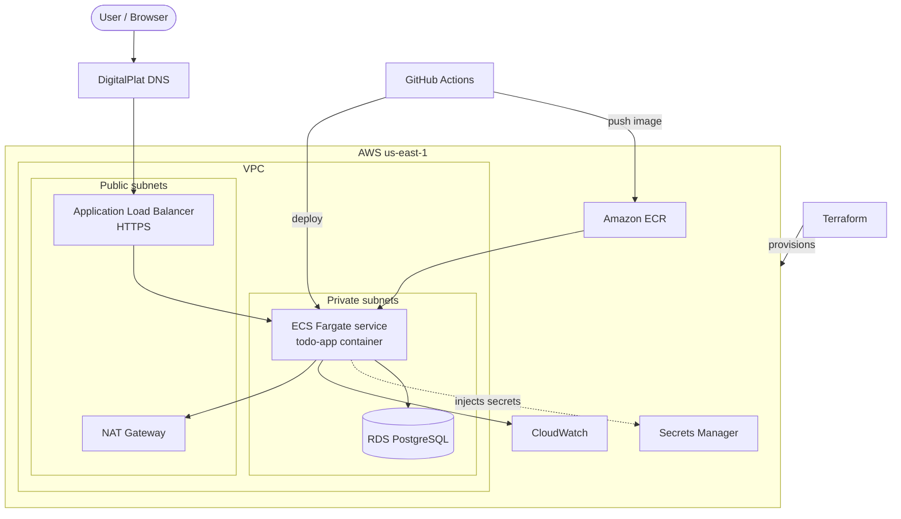

# Todo Application: AWS DevOps Challenge

A Node.js/Express Todo app deployed on AWS. Terraform provisions the infrastructure, Docker packages the app, ECS Fargate runs it, RDS PostgreSQL stores the data, and GitHub Actions handles CI/CD.

- **Repository:** https://github.com/anigbojohnson/DevOps-Challenge

> **The site is not live.** The infrastructure is not running. During development the app was served at `app.mytodo.dpdns.org`. To see it, deploy it and open the ALB DNS name (`terraform output application_url`), or use a domain you control. See [Viewing the app](#viewing-the-app).

## Contents

- [Architecture](#architecture)
- [Tech stack](#tech-stack)
- [Project structure](#project-structure)
- [Infrastructure](#infrastructure)
- [Terraform layout and state](#terraform-layout-and-state)
- [CI/CD pipeline](#cicd-pipeline)
- [Database migrations](#database-migrations)
- [Security](#security)
- [Monitoring and logging](#monitoring-and-logging)
- [Deployment](#deployment)
- [Viewing the app](#viewing-the-app)
- [Destroying the infrastructure](#destroying-the-infrastructure)
- [Design decisions](#design-decisions)
- [Limitations and next steps](#limitations-and-next-steps)

## Architecture

Two tiers:

1. **Application:** Node.js/Express containers on ECS Fargate, in private subnets.
2. **Database:** RDS PostgreSQL, in private subnets.

An Application Load Balancer (ALB) in the public subnets is the only public entry point and serves the app over HTTPS.



### Request flow

1. DNS resolves the domain to the ALB.
2. The ALB terminates HTTPS and forwards the request to a Fargate task.
3. The app queries PostgreSQL in the private subnets.
4. ECS injects the database credentials from Secrets Manager into the container at startup.
5. Logs go to CloudWatch.

## Tech stack

| Category | Technology |
|---|---|
| Backend | Node.js 22, Express |
| Frontend | HTML, CSS, JavaScript |
| Database | PostgreSQL 16 (`pg` driver) |
| Testing | Jest |
| Containers | Docker, ECS Fargate, ECR |
| Infrastructure as code | Terraform |
| CI/CD | GitHub Actions (OIDC authentication to AWS) |
| Networking and TLS | ALB, AWS Certificate Manager |
| Secrets and logging | Secrets Manager, CloudWatch |

## Project structure

```
.
├── .github/workflows/deploy.yml   # CI/CD pipeline
├── public/                        # Frontend (HTML, CSS, JS)
├── scripts/migrate.js             # Database migration script
├── src/
│   ├── app.js, server.js
│   ├── config/                    # database.js, schema.sql
│   ├── controllers/               # todoController.js
│   ├── routes/                    # todoRoutes.js
│   └── services/                  # todoService.js
├── tests/                         # todo.test.js, db.test.js
├── terraform/
│   ├── environments/{dev,production}/
│   └── modules/
├── Dockerfile
└── package.json
```

## Infrastructure

Everything is deployed in `us-east-1`. Dev and production use separate Terraform root configurations that share the same modules. Environment differences are passed in as inputs.

| Setting | Dev | Production |
|---|---|---|
| NAT Gateways | 1, shared by both private subnets | 2, one per AZ |
| ECS task CPU / memory | 256 (0.25 vCPU) / 512 MiB | 1,024 (1 vCPU) / 2,048 MiB |
| ECS desired / min / max tasks | 1 / 1 / 1 | 2 / 2 / 10 |
| RDS instance class | db.t4g.micro | db.t4g.small |
| RDS Multi-AZ | Disabled | Enabled |
| RDS storage | gp3, encrypted | gp3, encrypted |
| CloudWatch log retention | 7 days | Set in production `tfvars` |

Dev is tuned for low cost; production adds capacity and availability.

### Networking

- Dedicated VPC with two public and two private subnets across two AZs.
- Internet Gateway for the public subnets; NAT Gateway (or gateways) for outbound traffic from the private subnets.
- The environment input selects the number of NAT Gateways.

### Application Load Balancer

- Sits in the public subnets and uses an ACM certificate.
- Listens on HTTP and HTTPS. HTTP redirects to HTTPS.
- HTTPS traffic goes to the ECS target group.

### ECS Fargate

- Tasks use `awsvpc` networking, run in the private subnets with no public IP, and listen on port 3000 (container name `todo-app`).
- The service receives both private subnets, so ECS can spread tasks across AZs. It does not guarantee an even split.
- CPU and memory target-tracking policies (70%) scale between the minimum and maximum task counts.

### ECR

Repository `todo-app-dev`:

- Images are tagged with the Git commit SHA.
- Tags are immutable, images are scanned on push, and storage uses AES256 encryption.
- A lifecycle policy keeps the latest 10 images.

### RDS PostgreSQL

- PostgreSQL 16 in private subnets, no public access.
- Inbound access only from the ECS security group on port 5432.
- RDS manages the master password in Secrets Manager.
- Multi-AZ (production) gives failover. The standby does not serve reads.

## Terraform layout and state

```
terraform/
├── environments/
│   ├── dev/          # main.tf, outputs.tf, providers.tf, variables.tf, terraform.tfvars
│   └── production/   # same files
└── modules/
    ├── networking/     # VPC, subnets, gateways, routing
    ├── security/       # security groups
    ├── ecr/            # image repository
    ├── ecs/            # cluster, task definition, service, IAM roles
    ├── database/       # RDS and subnet group
    ├── load_balancer/  # ALB, listeners, target group, certificate
    ├── github_oidc/    # OIDC provider, deployment role, permissions
    └── monitoring/     # CloudWatch alarms and dashboard
```

State is stored in S3 with encryption and native locking (`use_lockfile = true`). The bucket `todo-list-1987` is in `eu-west-2`, which is independent of the `us-east-1` application region. It must exist before `terraform init`.

Each environment has its own state key:

```hcl
terraform {
  backend "s3" {
    bucket       = "todo-list-1987"
    key          = "state/dev/terraform.tfstate"   # production: state/production/terraform.tfstate
    region       = "eu-west-2"
    encrypt      = true
    use_lockfile = true
  }
}
```

## CI/CD pipeline

Defined in `.github/workflows/deploy.yml`. Triggers: push to `main`, pull requests to `main`, and manual dispatch.

**Build and test**

1. Check out the code, install Node.js 22, run `npm ci`.
2. Start a PostgreSQL 16 service container and create the test schema:
   ```bash
   psql -h localhost -U postgres -d todo_test -f src/config/schema.sql
   ```
3. Run `npm test` (Jest).

**Deploy** (runs only if build and test pass)

4. Build the image: `docker build -t todo-app:${GITHUB_SHA} .` The image is passed to the deploy job as an artifact.
5. Authenticate to AWS with OIDC. No long-lived access keys are stored in GitHub. The IAM trust policy is limited to this repository and branch.
6. Push the image to the environment's ECR repository (`ECR_REPOSITORY`), tagged with the commit SHA.
7. Register a new ECS task definition revision with the new image.
8. Run a one-off Fargate task from that revision with the command `node scripts/migrate.js`. The workflow waits for it to stop and checks the exit code. A non-zero exit stops the deployment.
9. Update the ECS service to the new task definition and wait for it to stabilise.

Migrations always finish before the new application version goes live.

### Environment variables

The workflow's `env` block in `.github/workflows/deploy.yml` names the target environment. Update it when deploying to production:

| Variable | Dev | Production |
|---|---|---|
| `AWS_REGION` | `us-east-1` | `us-east-1` |
| `ECR_REPOSITORY` | `todo-app-dev` | `todo-app-production` |
| `ECS_CLUSTER` | `todo-app-dev-cluster` | `todo-app-production-cluster` |
| `ECS_SERVICE` | `todo-app-dev-service` | `todo-app-production-service` |

```yaml
env:
  AWS_REGION: us-east-1
  ECR_REPOSITORY: todo-app-production
  ECS_CLUSTER: todo-app-production-cluster
  ECS_SERVICE: todo-app-production-service
```

- The names must match what Terraform creates in `terraform/environments/production`. Confirm them with `terraform output`.
- The `AWS_ROLE_ARN` secret must hold the production deployment role's ARN, and that role's trust policy must allow the branch that runs the workflow.

## Database migrations

- Schema: `src/config/schema.sql`
- Runner: `scripts/migrate.js`. It reads the schema, connects using the app's database config, runs the SQL, closes the connection, and exits non-zero on failure.

```sql
CREATE TABLE IF NOT EXISTS todos (
    id BIGSERIAL PRIMARY KEY,
    title VARCHAR(255) NOT NULL,
    description TEXT,
    completed BOOLEAN DEFAULT FALSE,
    created_at TIMESTAMPTZ DEFAULT CURRENT_TIMESTAMP,
    updated_at TIMESTAMPTZ DEFAULT CURRENT_TIMESTAMP
);
```

`IF NOT EXISTS` makes the script safe to re-run. Migrations run as a separate ECS task, not at app startup, so several containers never change the schema at the same time.

## Security

**Network**

- Only the ALB is public.
- ECS tasks accept traffic only from the ALB security group.
- RDS accepts traffic only from the ECS security group.

**IAM**

- GitHub Actions gets temporary credentials through OIDC, with a role restricted to this repository and branch.
- ECS uses separate task execution and task roles. The execution role reads the database secret.
- Permissions are scoped to the resources the deployment needs.

**Secrets**

- Database credentials come from Secrets Manager through ECS secret injection. They are not in the image or the repository.

**Database TLS**

- Production connections use SSL. The Docker image includes the AWS RDS CA bundle (`/app/global-bundle.pem`), which the app uses to validate the server certificate.
- The RDS parameter group sets `rds.force_ssl = 1`.

**HTTPS**

- ACM provides the ALB certificate for the configured domain. The certificate must cover the hostname used to reach the app.

## Monitoring and logging

- Application logs go to CloudWatch. The dev log group is `/ecs/todo-app-dev` (7-day retention). Production has its own group and retention.
- The monitoring module creates CloudWatch alarms and a dashboard for ECS, RDS and ALB metrics.
- ECS Container Insights is enabled on the cluster.

```bash
aws logs tail /ecs/todo-app-dev --since 15m --region us-east-1
```

## Deployment

### Prerequisites

- AWS account and AWS CLI
- Terraform 1.5 or later
- Git
- Node.js 22
- Push access to the GitHub repository
- The S3 state bucket, created beforehand

Docker is not needed locally; the GitHub runner builds the image.

```bash
aws sts get-caller-identity   # confirm you are authenticated
```

### Steps

1. **Clone**
   ```bash
   git clone https://github.com/anigbojohnson/DevOps-Challenge.git
   cd DevOps-Challenge/terraform/environments/dev
   ```
2. **Configure.** Review `terraform.tfvars` (region, database settings, GitHub repository, and so on). Do not commit credentials.
3. **Provision**
   ```bash
   terraform init
   terraform fmt -recursive
   terraform validate
   terraform plan
   ```
4. **Configure DNS.** Certificate validation is manual when DNS is hosted outside Route 53, so the first apply is split in two.
   1. Create the certificate only:
      ```bash
      terraform apply -target="module.load_balancer.aws_acm_certificate.app"
      ```
   2. Get the validation record:
      ```bash
      aws acm describe-certificate --certificate-arn <arn> --region us-east-1 \
        --query "Certificate.DomainValidationOptions[].ResourceRecord"
      ```
   3. At the DNS provider, add that CNAME. If the provider appends the zone name to the Value, add a trailing dot. Confirm it resolves:
      ```bash
      nslookup -type=CNAME <record-name> 8.8.8.8
      ```
   4. Run the full `terraform apply`. Validation completes within a few minutes.
   5. Add a CNAME for the app subdomain (for example `app`) pointing to the ALB DNS name from `terraform output`. Some providers, including DigitalPlat, do not allow a CNAME at the zone apex, so a subdomain is required.
5. **Add the GitHub secret** `AWS_ROLE_ARN` with the ARN of the Terraform-created deployment role (`terraform output` shows it if exposed).
6. **Deploy.** Push to `main`; the workflow does the rest.
7. **Verify**
   ```bash
   aws ecs describe-services --cluster todo-app-dev-cluster --services todo-app-dev-service --region us-east-1
   aws logs tail /ecs/todo-app-dev --since 15m --region us-east-1
   ```

### Terraform outputs

```bash
terraform output                       # all outputs
terraform output application_url
terraform output ecr_repository_url
terraform output ecs_cluster_name
terraform output ecs_service_name
terraform output database_endpoint
```

## Viewing the app

The deployment is not running, so there is no public URL. After deploying, there are two ways to view the app:

- **With a real domain name.** Set the domain in `terraform.tfvars` and make sure the certificate covers the hostname you will browse to (for example `app.mytodo.dpdns.org`, or a wildcard SAN `*.mytodo.dpdns.org`). Add the validation CNAME and a CNAME from that hostname to the ALB at your DNS provider. The app is then served at `https://<hostname>`.
- **With the ALB DNS name.** Open the address from `terraform output application_url`. The ACM certificate is issued for the domain, not the ALB hostname, so the browser will show a certificate warning.

## Destroying the infrastructure

```bash
cd terraform/environments/dev
terraform plan -destroy
terraform destroy
```

- The ECR repository has `force_delete = true`, so its images are deleted permanently.
- The S3 state bucket `todo-list-1987` is managed separately. Keep it to preserve state.
- The GitHub repository and DNS records are not removed unless Terraform manages them.

## Design decisions

| Decision | Reason |
|---|---|
| ECS Fargate | No EC2 worker nodes to manage. |
| Terraform modules | Each module has one job, and both environments reuse them. |
| RDS | Managed PostgreSQL with encryption and Secrets Manager integration. |
| GitHub OIDC | Temporary credentials instead of stored access keys. |
| Commit SHA image tags, immutable | Each deployed image traces back to a commit, and a tag can never be overwritten. |
| Separate migration task | Prevents concurrent schema changes and lets the pipeline stop on failure. |
| Private subnets | App containers and the database are not directly reachable from the internet. |

## Limitations and next steps

1. Replace the single `schema.sql` with a versioned migration framework.
2. Add automated smoke tests after deployment.
3. Add security checks to CI, including Terraform scanning and policy validation.
4. Add VPC endpoints to cut NAT Gateway data costs.
5. Improve database connection pooling and capacity management.
6. Test database backup restoration and document disaster recovery.
7. Tune ECS task sizing and autoscaling thresholds from load-test results.
